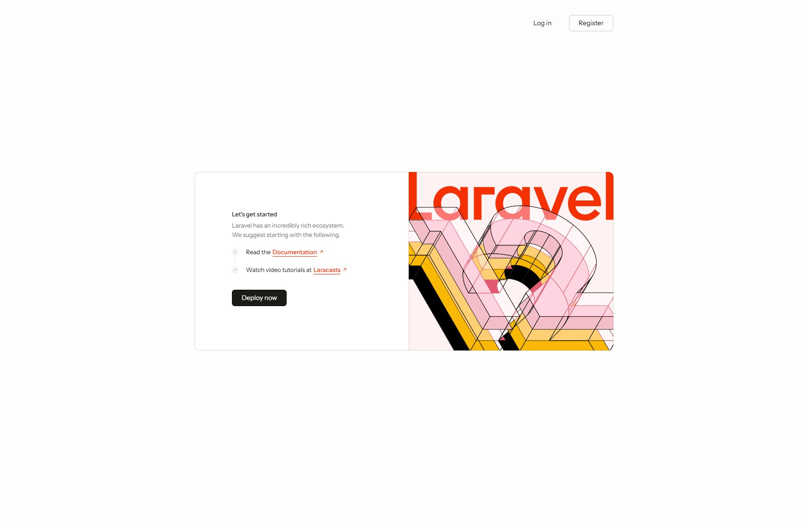
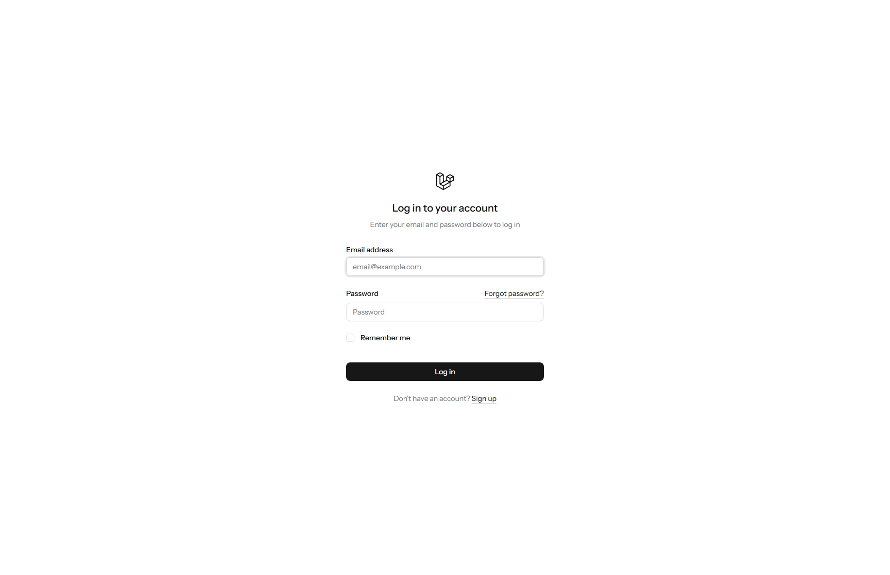

# ReactStart: Laravel + React Starter Kit

<div align="center">
  <p>A strict, production-ready starting point built with Laravel 13, React 19, Inertia.js 3, TypeScript 6, and Tailwind CSS 4.</p>

  [](https://github.com/aslamwebz/ReactStart/actions/workflows/tests.yml)
  [](LICENSE)
  [](https://www.php.net/)
  [](https://laravel.com)
  [](https://react.dev)
  [](https://inertiajs.com)
  [](https://www.typescriptlang.org/)
  [](https://tailwindcss.com)
  [](https://pestphp.com)
</div>

---

## Why ReactStart Exists

ReactStart exists to provide a strict, modern, fully tested foundation for full-stack web applications. Rather than starting from an unopinionated or loosely typed skeleton, ReactStart comes preconfigured with strict static analysis, complete test suites maintaining 100% code coverage, end-to-end browser automation, and comprehensive authentication flows out of the box.

## Screenshots

### Welcome Screen


### Authentication & Login


## What Is Included

- **Authentication**: Complete authentication workflows powered by Laravel Fortify, including user registration, session management, email verification, password reset, and secure password confirmation.
- **Two-Factor Authentication (2FA)**: Full TOTP-based two-factor authentication setup with QR code display, secure recovery code generation, and step-up challenge verification.
- **User Settings & Profile**: Profile detail editing, email modification, password updating, and account deletion with confirmation dialogs.
- **Appearance & Theming**: Integrated system, light, and dark mode theme switching with instant inline system preference detection to eliminate flash of unstyled content (FOUC).
- **Frontend Stack**: Built on React 19, Inertia.js v3, TypeScript 6, Tailwind CSS v4, Lucide React icons, and accessible Radix UI primitives with shadcn/ui styling.
- **Developer Tooling & Quality Assurance**:
  - **Pest PHP 5**: Enforced 100.0% line and branch test coverage.
  - **Type Coverage**: 100.0% Pest PHP type coverage.
  - **Browser Testing**: Native Pest 5 browser testing powered by Playwright.
  - **PHPStan / Larastan**: Strict static analysis for backend code.
  - **Rector**: Automated refactoring, type safety enforcement, and code modernization.
  - **Laravel Pint**: Strict PHP code styling.
  - **ESLint & Prettier**: Automated linting and formatting for TypeScript, TSX, and CSS.
  - **GitHub Actions CI**: Automated workflows for test suites, code quality linters, and headless browser tests.
  - **Dependabot**: Automated weekly dependency checks for Composer, npm, and GitHub Actions.

## Requirements

- PHP `~8.4.27 || ^8.5.12`
- Composer 2
- Node.js 22+
- npm 10+
- SQLite (default) or MySQL / PostgreSQL

## Quick Start

### 1. Clone the repository

```bash
git clone https://github.com/aslamwebz/ReactStart.git
cd ReactStart
```

### 2. Run automated setup

```bash
composer run setup
```

The setup script automatically:
1. Installs Composer dependencies
2. Copies `.env.example` to `.env` if not present
3. Generates the application key
4. Runs database migrations
5. Installs npm dependencies
6. Builds frontend production assets

Alternatively, setup can be performed manually:

```bash
composer install
npm install
cp .env.example .env
php artisan key:generate
php artisan migrate
npm run build
```

### 3. Start the development server

Run the combined server process (Laravel server, queue worker, and Vite dev server):

```bash
composer run dev
```

Or start the servers in separate terminal tabs:

```bash
# Terminal 1: Backend API & SSR
php artisan serve

# Terminal 2: Vite Dev Server with HMR
npm run dev
```

Open [http://localhost:8000](http://localhost:8000) in your browser.

## Testing and Code Quality

ReactStart enforces strict testing and code quality standards across the entire stack.

### Run All Tests

To run the complete quality pipeline (type coverage, unit and feature tests with 100% coverage, linting, and static analysis):

```bash
composer test
```

### Individual Test Suites

- **Unit & Feature Tests (100% Coverage)**:
  ```bash
  composer test:unit
  ```
- **PHP Type Coverage (100%)**:
  ```bash
  composer test:type-coverage
  ```
- **Static Analysis (PHPStan)**:
  ```bash
  composer test:types
  ```
- **PHP & Frontend Linting Check**:
  ```bash
  composer test:lint
  ```
- **TypeScript Type Check**:
  ```bash
  npm run test:types
  ```
- **Code Formatting & Automatic Fixes**:
  ```bash
  npm run format
  npm run lint
  vendor/bin/pint
  vendor/bin/rector
  ```

### Browser Tests

Browser tests use Pest 5 and Playwright to verify the real compiled application in a headless Chromium browser:

```bash
# Install Playwright browser binaries (one time)
npx playwright install --with-deps chromium

# Run browser tests
composer test:browser
```

## Continuous Integration

GitHub Actions workflows run on every push and pull request:

- `tests.yml`: Runs composer test (type coverage, unit/feature tests with 100% coverage, linting, PHPStan) on PHP 8.4 and Node 22.
- `linter.yml`: Enforces Pint and Prettier/ESLint styling.
- `browser-tests.yml`: Executes end-to-end browser tests in headless Chromium via Playwright.

## License

This project is open-source software licensed under the [MIT License](LICENSE).
